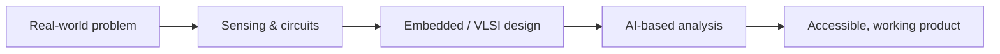

---

## 👩‍💻 About

I'm an **Electronics & Communication Engineering** student (B.Tech, CGPA 8.5) from Andhra Pradesh, India, with **8 months of internship experience** in embedded systems and VLSI.

My work sits where **hardware, AI and accessibility** meet: a smart cap for visually impaired users, an AI-assisted hearing-analysis system, autonomous robot navigation, and RF balun design.

🎯 **Seeking:** entry-level roles in **VLSI, Embedded Systems or AI-driven software**

---

## 🏆 Highlights

| | |
| --- | --- |
| 🥇 **1st Prize, National Level Hackathon** | Smart Cap for Blind People |
| 🎖️ **All India Rank 176** | National Entrepreneurship Challenge 2025, IIT Bombay |
| ☁️ **Microsoft Azure Fundamentals (AZ-900)** | Certified |
| 🌐 **Cisco IT Essentials** | Certified |

---

## 🚀 Selected Work

<table>
<tr>
<td width="50%" valign="top">

### 🧢 Smart Cap for Blind People

An assistive wearable that helps visually impaired users navigate their surroundings safely.

**Focus:** assistive technology · embedded systems
[View project →](LINK_TO_REPO)

</td>
<td width="50%" valign="top">

### 🦻 Smart Audiometer with AI-Based Hearing Analysis

An AI-assisted system for hearing analysis, aimed at accessible screening and early detection of hearing loss.

**Focus:** AI · healthcare accessibility
[View project →](LINK_TO_REPO)

</td>
</tr>
<tr>
<td width="50%" valign="top">

### 🤖 Autonomous Robot Navigation (ROS)

A robot with obstacle avoidance and path planning for autonomous navigation.

**Focus:** robotics · autonomy
[View project →](LINK_TO_REPO)

</td>
<td width="50%" valign="top">

### 📡 Design & Development of Baluns (VLSI / RF)

Designed and simulated balun circuits for RF applications to improve signal performance.

**Focus:** RF circuits · circuit simulation
[View project →](LINK_TO_REPO)

</td>
</tr>
</table>

---

## 💼 Experience

**Embedded Systems Intern · Microlinks** (6 months)
Built and tested real-time embedded applications on hardware platforms, with hands-on hardware interfacing and debugging.

**VLSI Intern · Skill Dzire** (2 months)
Worked through the complete VLSI design flow, from circuit design to simulation, using industry-standard tools.

---

## 🛠️ Skills

**Languages**

**VLSI, RF & EDA**

**Embedded & Robotics**

**AI & Cloud**

---

## 🎓 Education

- **B.Tech, Electronics & Communication Engineering**: QIS College of Engineering and Technology, Ongole (2024 – 2027) · CGPA 8.5
- **Diploma, Electronics & Communication Engineering**: Smt. B. Seetha Polytechnic, Bhimavaram (2021 – 2024) · CGPA 8.5

---

## 📊 GitHub Activity

---

## 🤝 Let's Connect

Open to conversations about **VLSI, embedded systems, assistive technology and AI**.

📧 bhavanineelapaladev01@gmail.com · 💼 [LinkedIn](https://www.linkedin.com/in/neelapala-naga-durga-bhavani-885b393ba)

*"Technology works best when it works for everyone."*

